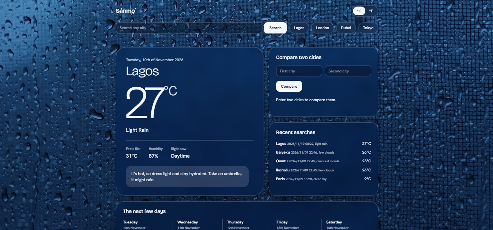

# Sánmọ̀: a weather app in Python

It is a weather app that runs two ways: as a command-line program and as a website with a live video background that changes with the weather. It uses the OpenWeatherMap API.

The name is based on the Yoruba word for sky.

## What it does

- Current weather for any city, with a clothing/accessory suggestion
- 5-day forecast
- Compare two cities side by side
- Search history saved to a CSV file
- Celsius and Fahrenheit
- Website with a sky video that matches the weather and the time of day



## What you need

- Python 3.10 or newer
- A free API key from [OpenWeatherMap](https://openweathermap.org/api)

## Setup

1. Install the libraries:

```
pip install requests flask
```

2. Save your API key as an environment variable (this will keep it out of the code).
On Windows, then restart your terminal:

```
setx WEATHER_API_KEY "your_key_here"
```

## To run the command-line app

```
python weather.py
```

## To run the website

```
cd weather-web
python app.py
```

Then open http://127.0.0.1:5000 in your browser.

### Background videos

The videos I used are not included in this repository due to their large size. To use the video feature, add eight short MP4 clips to `weather-web/static/videos/` with these exact names:

`clear-day.mp4`, `clear-night.mp4`, `partly-cloudy.mp4`, `clouds.mp4`, `rain.mp4`, `storm.mp4`, `snow.mp4`, `fog.mp4`

Without them the site still works, but it falls back to an animated gradient that looks pretty cool.

## How it is built

- `weather.py`: the command-line app
- `weather-web/app.py`: the Flask server that talks to the weather service
- `weather-web/templates/index.html`: the web page

## What I learned

I started this as a total beginner and first learned how to pull live data using an API, read the JSON it sends back, and handle whatever goes wrong, like a typo in a city name or no internet. The biggest lesson overall was learning that bugs usually come from small things like wrong indentation or using the wrong variable, and that constantly printing values to see what’s happening is the quickest way to find them and understand what your code is doing. After daily tinkering and frustrations, I've turned my simple terminal script into a full website with Flask, and I actually understand how the pieces talk to each other.
